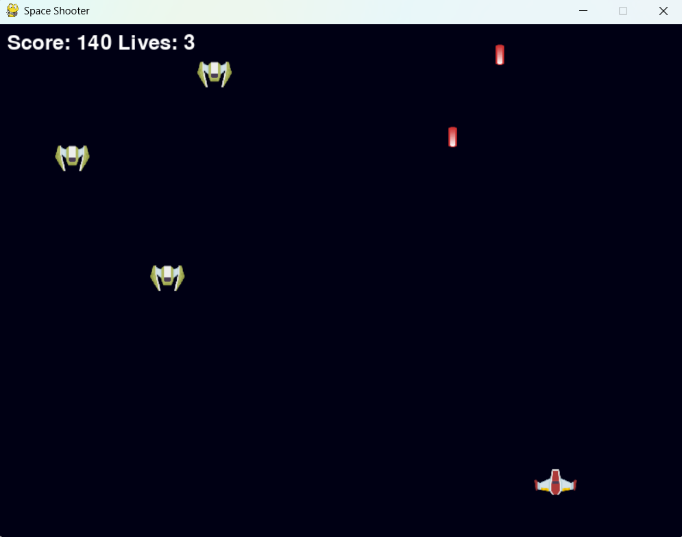

# Space Shooter

A simple space shooter game written in Python with pygame-ce.



## Features

- Move the ship and shoot bullets
- Enemies appear at random positions
- Collision detection between bullets, enemies and the ship
- Score and lives shown on the screen
- Game Over message
- Image for the ship, enemies and bullets

## Controls

- Left and Right arrow keys: move the ship
- Space: shoot a bullet

## Setup

1. Install Python 3.
2. Install the library:

```
pip install -r requirements.txt
```

## How to run

```
python main.py
```

## What I learned

- Classes and objects (`Bullet` and `Enemy`)
- How the game loop works
- Handling keyboard events
- Detecting collisions with `Rect`
- Controlling the speed of the game with `clock.tick` (FPS)
- Showing text on the screen with fonts